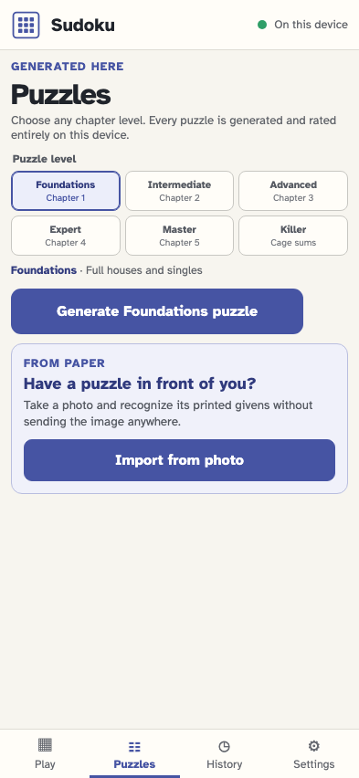
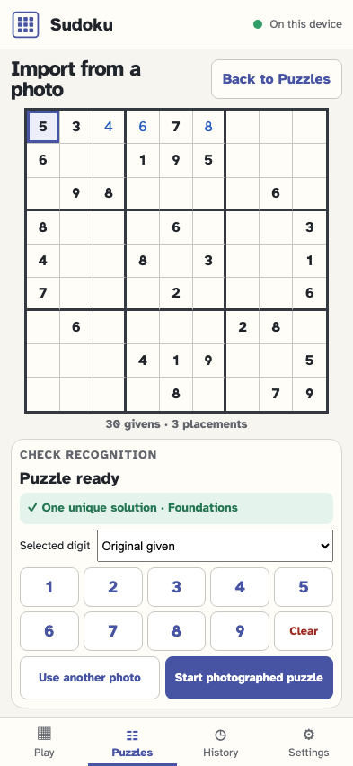
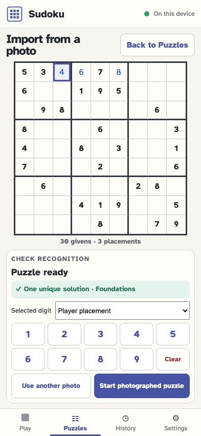
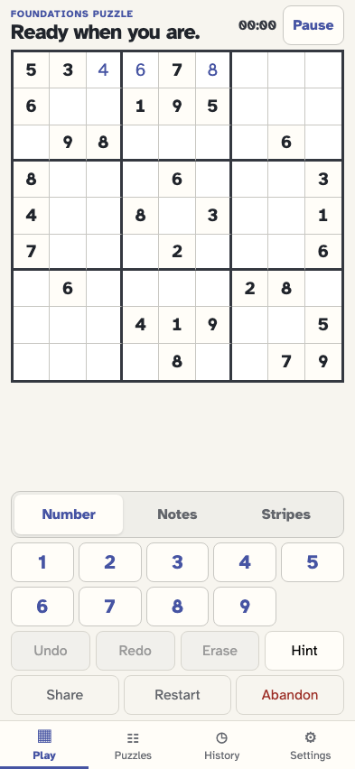

# Import a printed Sudoku with the camera

A player can photograph a grid, recognize original givens and distinct full-size player placements on-device, correct digits and roles, validate the original puzzle, and resume with that progress.

## The puzzle library offers private photo import beside generation

**Verifications:**

- [x] The photo option explains that the image is not sent anywhere

## The confident givens are checked and presented for acceptance

**Verifications:**

- [x] Every printed clue and player placement lands in its own layer; blank cells stay empty
- [x] The clean review is already proven and remains unsaved

## The corrected grid is proven before import

**Verifications:**

- [x] The review confirms one unique solution and its logical rating

## The photographed puzzle starts as a private local attempt

**Verifications:**

- [x] The playable board preserves the photographed givens
- [x] One camera-photo origin records the validated puzzle but never the image
