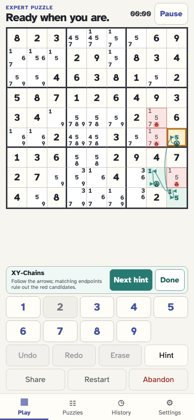
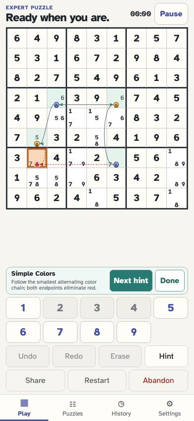

# Follow arrows between candidate shapes

As a solver, I can follow visual-hint arrows that start and end at the side boundaries of candidate boxes and ellipses, centered vertically, including after resizing the board.

## XY-Chains links meet the highlighted shapes at mid-height without crossing their digits

**Verifications:**

- [x] Every candidate-arrow endpoint meets a measured shape boundary, with the marker tip on its endpoint

## Simple Colors links meet the highlighted shapes at mid-height without crossing their digits

**Verifications:**

- [x] Every candidate-arrow endpoint meets a measured shape boundary, with the marker tip on its endpoint
